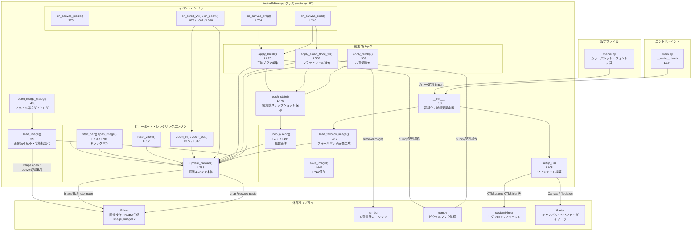
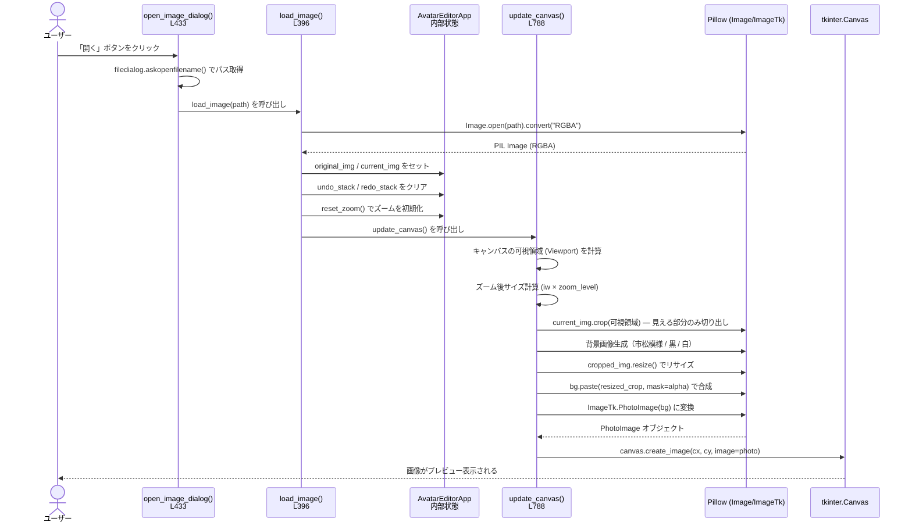
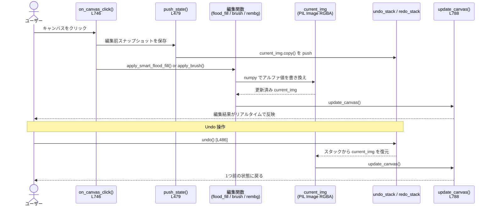

# Artemis Background Remover — アーキテクチャ図

## 1. 全体構成（コンポーネント依存関係）



---

## 2. 画像アップロード → プレビュー表示のデータフロー



---

## 3. 編集操作のデータフロー（Undo/Redo 含む）



---

## 4. ファイル構成

```
artemis-bg-remover/
├── main.py           # アプリ全体（AvatarEditorApp クラス、936行）
├── theme.py          # カラーパレット・フォント・レイアウト定数
├── requirements.txt  # 依存ライブラリ定義
├── README.md         # セットアップ・使い方ドキュメント
├── architecture.md   # このファイル（アーキテクチャ図）
├── mkdocs.yml        # ドキュメントサイト設定
├── docs/             # ドキュメント格納ディレクトリ
└── .github/          # GitHub Actions 等の設定
```
